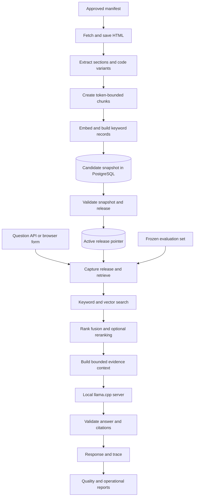

# FastAPI documentation RAG: implementation plan

Prepared: November 5, 2026.

Status update (November 11, 2026): milestone 1 and agent-owned implementations for milestones 2–4 are verified and merged into `main`. The owner deferred human label and policy reviews as action items; semantic quality gates remain open, and some milestone-0 setup work remains. See [the milestone-3 handoff](milestone-3-handoff.md) and [milestone-4 handoff](milestone-4-handoff.md) for runtime evidence and limitations. The next implementation milestone is 5, cited generation through the CLI. Environment observations and defaults below describe the original planning baseline unless a later milestone report supersedes them. This document expands the RAG project in the supplied portfolio plan and applies the later decision to use official FastAPI documentation instead of Python documentation.

## 1. What we are building

A local documentation assistant for developers learning and implementing FastAPI. A user asks a question, the service finds supporting passages in a fixed documentation snapshot, and a local language model produces an answer with citations. If the available evidence cannot support an answer, the service returns an explicit insufficient-evidence result.

Example question: “How do I use a dependency with `yield` to clean up a database session?” The answer should explain the documented dependency lifecycle and cite its supporting section. It should not invent details about an unspecified database driver.

The engineering deliverable includes the complete evidence pipeline: acquisition, parsing, chunking, search, answer generation, evaluation, updates, rollback, and operational measurements.

### Completion criteria

- A clean setup can import the approved English tutorial manifest and answer through an API and a small browser form.
- Every returned citation resolves to a passage actually supplied to the model and includes a source section URL and snapshot identity.
- Keyword, vector, hybrid, and reranked hybrid retrieval can be compared using the same frozen questions and corpus.
- A failed import cannot become active; a completed replacement can be activated and rolled back without mixing snapshots within a request.
- Repeated identical imports reuse a completed snapshot rather than accumulating duplicate copies.
- Unsupported questions, model outages, malformed citations, and overload produce distinct, inspectable outcomes.
- Another developer can reproduce the measured demonstration using documented commands, model identities, and artifact checksums.

### Boundaries

The first release supports English tutorial documentation, single-turn questions, one local operator, and one active corpus. It has no user accounts, conversation memory, arbitrary URL ingestion, file uploads, autonomous tools, or execution of generated code. Advanced documentation and deployment pages are a later corpus expansion with their own evaluation update.

The final application is a portfolio service with tested reliability properties. Its security and quality claims must describe the cases actually measured.

## 2. Working decisions and prerequisites

These are proposed implementation defaults. Lock exact versions when the first runnable environment passes its compatibility checks; a planning document cannot establish working package combinations.

| Area | Starting choice | Reason and verification |
|---|---|---|
| Python | Project-managed Python 3.12 through `uv` | Keep ML dependency compatibility independent of the machine's default Python; verify installation in milestone 0 |
| Application | FastAPI, Pydantic settings, Uvicorn | Typed request boundaries and a small HTTP surface |
| Database | PostgreSQL with pgvector | One durable store for metadata, full-text search, vectors, jobs, and reports |
| Database access | Psycopg 3 and numbered SQL migrations | The important queries are PostgreSQL-specific; use parameterized SQL directly |
| HTTP and parsing | HTTPX and Beautiful Soup | Explicit download limits and a parser we can test against saved HTML |
| Embedding | `sentence-transformers/all-MiniLM-L6-v2` | Retain the supplied plan's small baseline; it emits 384-dimensional vectors and truncates beyond its default 256 word-piece input limit. [Model card](https://huggingface.co/sentence-transformers/all-MiniLM-L6-v2) |
| Reranking | `cross-encoder/ms-marco-MiniLM-L6-v2` | Retain the original baseline and test its value on FastAPI questions. [Model card](https://huggingface.co/cross-encoder/ms-marco-MiniLM-L6-v2) |
| Answer model | Qwen2.5-1.5B-Instruct GGUF, initially Q4_K_M, through llama.cpp | A small integration baseline, subject to hardware and quality checks. The official artifact offers this quantization and carries Apache 2.0 metadata. [Official model](https://huggingface.co/Qwen/Qwen2.5-1.5B-Instruct-GGUF) |
| Tests and style | pytest and Ruff | Check contracts, SQL behavior, and failure cases without a large tooling stack |
| Runtime | PostgreSQL in Compose; Python API/worker and llama.cpp native during development | Make failures easy to inspect; containerize the API/worker for the reproducible release |
| Operator interface | `python -m fastapi_docs_rag ...` using argparse | Avoid introducing a CLI framework |
| UI | One HTML page served by FastAPI | A question field, answer, evidence, snapshot, and timing display |

Observed environment: ARM64, `uv` and `gh` available, default `python3` reports 3.15.2, and `docker` was not found on PATH. Available RAM and container-runtime status were not established. We will check them before model selection or runtime installation. These observations do not prove that Python 3.12, PostgreSQL, or model serving currently works.

Do not add Redis, Celery, a separate vector database, an orchestration framework, or approximate vector indexes initially. Add complexity only when a measured requirement earns it. Full job status, snapshot safety, validation, and meaningful failure tests remain required.

## 3. How the system fits together

There are three entry points into one Python package: the web API, an operator CLI, and a single durable-job worker. They share ingestion, retrieval, answering, and evaluation functions. PostgreSQL is the source of truth; disk holds immutable downloaded artifacts and exported reports. llama.cpp is a separate local inference process.



### Package layout, created as each part is needed

```text
fastapi-docs-rag/
  AGENTS.md
  pyproject.toml
  uv.lock
  compose.yaml
  .env.example
  .gitignore
  src/fastapi_docs_rag/
    api.py                 # routes and lifespan-managed resources
    settings.py            # runtime boundaries and validated settings
    db.py                  # connections, migrations, shared SQL access
    cli.py                 # operator commands
    worker.py              # durable single-worker job loop
    ingest.py              # manifest, fetching, snapshot construction
    parse.py               # HTML -> ordered section/block records
    chunk.py               # section blocks -> bounded search passages
    retrieve.py            # keyword/vector/fusion/rerank pipeline
    answer.py              # context, model request, citation validation
    evaluate.py            # dataset checks, metrics, report export
    templates/index.html   # introduced when the API works
  migrations/
  corpus/manifests/
  config/                  # immutable, named experimental profiles
  evals/                   # labeled questions, splits, review rubrics
  tests/fixtures/          # small HTML, model-response, and label fixtures
  tests/unit/
  tests/integration/
  data/                    # ignored downloads and runtime artifacts
  reports/                 # reviewed, shareable benchmark exports
  docs/agents/
  docs/adr/                # created when a decision needs an ADR
  docs/rag-implementation-plan.md
  .scratch/                # local specs and individual implementation issues
```

Keep modules as ordinary functions and small data structures. Split a module only when responsibilities or tests become hard to follow. Avoid generic repository, provider, pipeline, and service class hierarchies.

### Internal connection contracts

| Boundary | Required information | Owner of validation |
|---|---|---|
| Manifest -> fetcher | Manifest version, canonical URL, selected variant policy | Ingestion validates approved origin/path and uniqueness |
| Fetcher -> parser | Saved HTML, final URL, fetch time, raw hash | Fetcher checks status, size, redirects, content type |
| Parser -> chunker | Title, heading path, anchor, ordered prose/code/table blocks, variant labels | Parser checks meaningful article content and code retention |
| Chunker -> indexer | Stable evidence location, exact text, embedding input, token counts, hashes | Chunker checks model bounds and deterministic output |
| Retriever -> context builder | Chunk identity, source, scores/ranks, variant, selected text | Retriever enforces one snapshot and compatible embedding identity |
| Context -> generator | Question, evidence IDs, bounded text, profile identity | Context builder enforces token budget and source isolation |
| Generator -> response | Status, answer text, cited evidence IDs | Answer service validates schema and citation membership |
| Request -> evaluation | Release identity, stage outputs/timings, outcome | Evaluation checks dataset compatibility and metric denominators |

## 4. Corpus acquisition and parsing

### 4.1 Start with a small approved manifest

Use the [official English Tutorial – User Guide](https://fastapi.tiangolo.com/tutorial/) as the source boundary. Start with eight pages covering first steps, path parameters, query parameters, request bodies, response models, basic dependencies, dependencies with `yield`, and testing. Then curate approximately 40–60 relevant tutorial pages, including security and middleware. The exact approved URL count is authoritative; reaching an arbitrary count is not a completion gate.

Discover candidate links from the tutorial navigation once, review them, and commit a sorted manifest. The runtime importer reads that manifest rather than recursively following links. Its identifier and hash become part of snapshot provenance.

Manifest entries carry a canonical HTTPS URL and optional variant selection. Remove fragments for fetching, reject query strings for this corpus, and retain section fragments only in extracted evidence. Restrict paths to `/tutorial/` initially. Reject alternate hosts, translated paths, credentials, non-HTTPS schemes, and redirects outside the allowed origin/path.

### 4.2 Save a reproducible capture

Fetch sequentially initially, with a pause between pages and bounded retries for transient failures. Initial controls: one request at a time, a 20-second request timeout, a 5 MiB decompressed response ceiling, and at most three attempts. Honor `Retry-After` within an operator-defined deadline. Retry safe reads; do not retry permanent 4xx errors except an explicitly handled rate limit.

Save raw HTML content-addressed by SHA-256, with a capture manifest recording URL, final URL, fetched-at UTC, response metadata, and hash. Only a complete manifest with every required page succeeds. Missing pages, oversized responses, or extraction failures fail the candidate snapshot and produce an actionable page-level report.

Call this a **captured documentation snapshot**, not a FastAPI release snapshot. Live pages fetched over an interval are not proof of one upstream Git commit or package version. Record the interval. If we later need a specific FastAPI release, build and capture docs from its pinned source revision.

### 4.3 Parse article content and code deliberately

Inspect saved HTML from representative pages before choosing selectors. Extract the main article, discard navigation and unrelated chrome, preserve h1–h6 hierarchy and anchor IDs, and convert ordered content into typed blocks: paragraph, list, table, code, and callout. Keep code whitespace and language metadata. Capture both table headers and cell values.

FastAPI's [rendered First Steps page](https://fastapi.tiangolo.com/tutorial/first-steps/) is a useful initial parser fixture. Make separate fixtures for dependencies, long code, a table, a warning, and tabbed code examples. The fixture assertions come from manual inspection of the captured HTML rather than assumptions about every page sharing one layout.

For tab groups, preserve all captured panels with their tab labels. Select one consistent modern Python/`Annotated` variant for a normal answer context when available. Keep alternatives labeled and prevent duplicate variants from occupying all context slots. If a relevant example is missing from the downloaded HTML, report it and resolve capture before expanding the corpus; add browser rendering only if the captured HTML actually requires it.

Two hashes serve different purposes: `raw_hash` identifies exact downloaded bytes; `content_hash` identifies canonical parsed blocks. A navigation or formatting change may alter the first without altering searchable content. Include parser version in processed-artifact identity.

### 4.4 Acceptance checks

- Each seed page produces its expected title, at least one meaningful section, and the expected inspected code examples.
- Every stored nonempty anchor exists in the captured page; an anchorless section cites the page URL.
- Tab labels remain attached to their code; indentation survives exactly.
- A navigation-only page or a changed article selector fails loudly.
- A second parse of the same saved input with the same parser version yields identical blocks and hashes.

Learning outcome: understanding why document structure and provenance affect retrieval quality before introducing models.

## 5. Chunking and identity

### 5.1 Build short passages with enough context

Split within sections first. Construct the embedding input from title, compact heading path, variant label when needed, and passage text. Count using the pinned embedding tokenizer including special tokens. Start with approximately 180 body tokens and up to 30 overlap tokens; dynamically shrink the body budget when headings are long so the complete input stays within the loaded model's limit.

Keep short code blocks whole with nearby explanation. For oversized code, split at line boundaries, retain heading/variant context, and mark the fragment as partial. If one line alone exceeds the input budget, split at tokenizer boundaries and mark that limitation explicitly. Store the original complete code block separately inside the document's parsed blocks. A generation context may expand a retrieved fragment to that block only if it fits and its inclusion is recorded.

Do not describe a partial fragment as a standalone runnable program. Do not silently embed only the beginning of longer stored text.

### 5.2 Separate searchable chunks from durable evaluation evidence

Use three identities:

- `document_id`: one page record inside one snapshot.
- `chunk_id`: one searchable passage inside that snapshot and processing profile.
- `evidence_key`: canonical URL, anchor or block locator, parsed content hash, and supporting text span; used to map reviewed labels to chunks.

Derive deterministic chunk keys from document content hash, chunker version, heading/variant identity, and block/token span. Include snapshot identity in stored row identity. A changed chunker should create a new processing snapshot rather than mutate an existing one.

Evaluation labels point to human-reviewed spans, not only chunk IDs. On each processing version, map those spans into its chunks and save the mapping. Missing or ambiguous mappings fail dataset validation and require review. This allows a fair chunk-size experiment without treating old chunk IDs as universal truth.

### 5.3 Tests

Check deterministic output, bounded embedding inputs, preserved code order, long headings, oversized code, Unicode, stable source anchors, and zero accidental cross-variant concatenation. Assert that every accepted non-navigation content block is either represented in chunk spans or explicitly excluded with a recorded reason.

## 6. Database, snapshots, and jobs

### 6.1 Initial logical schema

Use UUIDs for run identities, UTC timestamps, foreign keys, checked statuses, and unique constraints. Keep metadata in typed columns where queries depend on it; use JSONB for immutable profiles and detailed reports.

| Table | Core fields | Integrity rule |
|---|---|---|
| `snapshots` | ID, manifest hash, corpus fingerprint, parser/chunker versions, capability, embedding model/revision/dimension, state, counts, capture interval | `building -> ready` or `failed`; ready content is immutable |
| `documents` | ID, snapshot ID, canonical URL, title, raw/content hashes, artifact paths, parsed blocks | One URL per snapshot |
| `chunks` | ID, document/snapshot IDs, evidence locator, heading/variant, exact text, embedding input hash, token counts, `tsvector`, `vector(384)` | Unique processing span per document; document and chunk snapshots must agree |
| `jobs` | ID, kind, state, input, attempt linkage, progress, result reference, error, timestamps | Durable `queued -> running -> succeeded|failed` transition |
| `releases` | ID, snapshot ID, complete serving profile, profile hash, validation report, creation time | Immutable configuration bound to a ready compatible snapshot |
| `active_release` | Singleton key and release ID | One atomic pointer, changed only by operator action |
| `evaluation_runs` | ID, release/config IDs, dataset hash, state, aggregate metrics, artifact reference | A run identifies both corpus and experiment |
| `evaluation_results` | Run/question IDs, retrieved evidence, answer outcome, metrics, review fields | Unique question per run |
| `request_traces` | Request ID, release ID, stage timings, selected evidence IDs, outcome, token usage | No model prompts or raw questions in routine logs by default |
| `answer_cache` | Key, validated answer payload, originating trace, creation/expiry | Added with milestone 7; keys include complete release identity |

For simplicity, complete snapshots may each contain their own document and chunk rows. That deliberate duplication across versions makes isolation clear. Within a snapshot, repeated pages/chunks are forbidden. A successful identical import returns its existing snapshot; a changed version creates a new one. Storage deduplication beyond shared raw artifacts is a later measured optimization.

During early development, capability is `keyword_only` and embedding metadata/vectors may be absent. A `vector_ready` snapshot requires complete, compatible embeddings for every searchable chunk. Moving between capabilities builds a new snapshot. The serving releases described here require `vector_ready`; early keyword CLI experiments explicitly request their snapshot and do not need a serving release.

### 6.2 Fingerprints and embedding reuse

The corpus fingerprint covers the sorted canonical URL/content-hash pairs, manifest policy, parser and chunker versions, and embedding model/tokenizer revision/settings. Fetch timestamps are provenance, not content identity.

Reuse prior embeddings only when the exact embedding input hash, model revision, tokenizer revision, normalization, and dimension agree. Copy reusable vectors into the candidate snapshot. A model, parser, or chunker change invalidates the relevant processing identity even if the source URL is unchanged.

Index `snapshot_id` and document identities with B-trees and the search vector with GIN. Start vector retrieval with exact cosine-distance ordering scoped to the snapshot. pgvector supports exact search without an approximate index; approximate indexing changes the recall/speed tradeoff. Add HNSW only after profiling shows a need and an exact-search comparison protects recall. [pgvector documentation](https://github.com/pgvector/pgvector)

### 6.3 Safe publication and rollback

Build candidate rows in bounded transactions while they remain inactive. Validate expected pages, source anchors, chunk token limits, unique keys, and smoke retrieval; vector-ready snapshots also require finite vectors with matching dimensions for every chunk. Mark a snapshot ready only after all capability-specific checks pass. Create a release binding it to the complete answer/retrieval profile and a passing validation report.

Activation updates the singleton active pointer in a short database transaction. Capture `release_id`, `snapshot_id`, and the immutable serving profile once at question start; use them for the entire request and cache lookup. Avoid holding a database transaction open while waiting for generation.

Rollback selects an earlier validated compatible release, restoring both corpus and serving configuration. Preload or verify required local models before switching; refuse activation if the running service cannot serve that release. The initial service supports the pinned embedding family and declared compatible model artifacts. It does not perform invisible downloads during a question.

Old releases and referenced snapshots remain available. Cleanup is an explicit later operator action; never delete an active snapshot or one needed by an in-flight request, benchmark, or retained release.

### 6.4 Durable work without a queue service

The CLI initially runs imports synchronously. Once ingestion works, the API creates a `jobs` row and returns HTTP 202; a separate worker executes the same function. Do not put durable ingestion or evaluation solely into FastAPI's in-process background tasks. Its documentation distinguishes simple background work from heavier work that may require separate processes. [FastAPI background tasks](https://fastapi.tiangolo.com/tutorial/background-tasks/)

Start with one worker holding a PostgreSQL session advisory lock for its lifetime. Only that worker claims jobs. On startup after obtaining the lock, mark orphaned running jobs failed and mark their unfinished snapshots failed; queue a new attempt explicitly. A retry creates a fresh candidate snapshot, reusing verified saved artifacts and embeddings where possible. This restart-from-artifacts policy avoids implementing distributed leases or complex partial resume.

Persist page/chunk counts and the failing stage. A worker must still own its database lock/session before reporting completion. If connectivity is lost, stop the attempt and reconcile on restart. Activation remains a separate guarded operation, so a stale or interrupted worker cannot publish partial data.

## 7. Retrieval and evidence selection

### 7.1 Keyword baseline

Create a weighted search vector with title/heading terms above body terms. Start with PostgreSQL's `simple` text-search configuration to retain technical terms predictably; compare `english` only as a development experiment. Use `websearch_to_tsquery` for user-entered search text and `ts_rank_cd` for ranking. These are PostgreSQL full-text functions; they are not BM25. [Text-search controls](https://www.postgresql.org/docs/current/textsearch-controls.html)

Filter by captured snapshot ID in the SQL itself. Return text and source metadata with stable tie-breaking by chunk ID. Inspect behavior on `Depends`, `response_model`, `HTTPException`, and `yield`; tokenization behavior must be measured rather than assumed to preserve every code identifier.

### 7.2 Vector and hybrid retrieval

Embed the question with the same pinned model and normalization used for the snapshot. Reject overlong input at the API boundary or return an explicit question-length error before model truncation. Retrieve 20 keyword and 20 exact vector candidates initially.

Merge by reciprocal rank fusion:

```text
RRF(chunk) = sum(1 / (60 + rank_in_list))
```

Use ranks starting at 1; a missing candidate contributes zero. Deduplicate by chunk identity and break ties deterministically. Retain per-source ranks in diagnostic results. The value 60 is a starting hyperparameter, not a confidence score.

### 7.3 Reranking and context construction

Rerank the top 20 fused candidates with question/passage pairs, then select up to five passages within the generation budget. Retrieve-then-rerank is the documented Sentence Transformers pattern. [Retrieve and rerank](https://www.sbert.net/examples/sentence_transformer/applications/retrieve_rerank/README.html)

Count the complete question/passage pair with the reranker tokenizer; shorten passage text deliberately when needed and record it. Treat raw cross-encoder scores as ranking signals, not calibrated probabilities.

Prefer distinct supporting sections over almost identical overlap chunks. Merge adjacent selected spans only when ordering and variant metadata agree; record the constituent chunk IDs. A context entry can include an expanded original code block from the same document when budget permits. Every included span remains traceable.

Assign request-local evidence IDs such as `E1` and `E2` after final selection. Count the final chat prompt using the generation model's tokenizer/template, including delimiters and special tokens. Reserve output capacity and a safety margin. llama.cpp documents tokenization and chat-template endpoints that can support this check. [Server documentation](https://github.com/ggml-org/llama.cpp/tree/master/tools/server)

Initial generation budget: 4,096 total tokens, up to 768 output tokens, and a 256-token safety margin. Fit instructions, question, and evidence into the remainder. These are local operating settings, subject to the hardware check.

### 7.4 Evidence sufficiency

No retrieved passages means immediate insufficient evidence. Nonempty retrieval requires a calibrated gate and model abstention policy: similarity to some text is not proof that the question is answerable.

On the development split, examine top reranker scores, supporting-section coverage, and failure categories. Choose a threshold policy for the reranked profile and report answerable-question rejection alongside unsupported-question acceptance. Retrieval-only baselines do not need this threshold. A serving profile without reranking needs its own calibrated policy; do not reuse a raw threshold across score scales.

For questions requiring multiple distinct facts, grade whether the selected context covers all required evidence groups. A high top score alone cannot establish that coverage.

## 8. Generation, citations, and API behavior

### 8.1 Answer protocol

The model receives an instruction to use supplied evidence, treat document text as untrusted data, cite substantive claims, preserve the meaning of code, and abstain when support is incomplete. Documents never grant tools or change system instructions.

Request a structured result with `status`, `answer_markdown`, and `cited_evidence_ids`. Use llama.cpp's supported structured-output mechanism after checking the pinned server version. Validate the returned object with Pydantic. Do not scrape a plausible answer from malformed output.

For an `answered` result, require nonempty text, at least one valid citation, and valid inline evidence references for substantive answer/code blocks. Ensure listed IDs and inline IDs agree. Map IDs to trusted database URLs in the application; never accept model-generated destination URLs as citations.

An insufficient-evidence result has a standard concise explanation and no asserted solution. A provider outage is an error, not an abstention. Unknown IDs, invalid structure, or missing mandatory references produce `invalid_model_output`; start without automatic repair retries so failures remain visible.

Structural citation checks cannot prove entailment. Human-reviewed claim support and code correctness remain separate evaluation tasks.

### 8.2 HTTP interfaces

| Interface | Behavior | Introduced |
|---|---|---|
| `GET /health/live` | Process liveness only | Milestone 0 |
| `GET /health/ready` | Database, active compatible release, required loaded models/server | Milestones 2–6 |
| `POST /questions` | Answer, citations, release/snapshot IDs, outcome, timings | Milestone 6 |
| `POST /ingestions` | Queue import by approved manifest name; 202 and job ID | Milestone 7 |
| `GET /jobs/{job_id}` | State, stage, counts, result, sanitized failure | Milestone 7 |
| `POST /evaluations` | Queue known dataset/profile evaluation; 202 and job ID | Milestone 7 |
| `GET /evaluations/{run_id}` | Aggregate results and question-level failures | Milestone 7 |
| `GET /metrics` | Operational counters and timing histograms | Milestone 8 |
| `GET /` | Minimal question/evidence interface | Milestone 8 |

Inspect retrieval through an operator CLI before adding an HTTP diagnostics route. Activation and rollback are operator CLI actions. Admin endpoints accept known names, not caller-supplied filesystem paths or arbitrary URLs. Bind to loopback for the local release. Publishing remotely requires a separate exposure/authentication decision.

Request shape:

```json
{"question": "How do dependencies with yield clean up resources?"}
```

Response shape, with illustrative placeholders rather than measured output:

```json
{
  "request_id": "<uuid>",
  "release_id": "<uuid>",
  "snapshot_id": "<uuid>",
  "status": "answered",
  "answer_markdown": "<evidence-supported explanation> [E1]",
  "citations": [{
    "id": "E1",
    "chunk_ids": ["<uuid>"],
    "title": "<captured page title>",
    "url": "https://fastapi.tiangolo.com/tutorial/dependencies/dependencies-with-yield/",
    "section_anchor": "<captured anchor>",
    "evidence_excerpt": "<exact supplied span>"
  }],
  "timings_ms": {"retrieval": "<number>", "generation": "<number>", "total": "<number>"},
  "cache_hit": false
}
```

Use numeric timing values in the real schema. Return 200 for both valid answered and insufficient-evidence outcomes, 422 for invalid questions, 503 for unavailable dependencies/no active release/overload, 504 for an expired upstream generation deadline, and 502 for malformed upstream model output. A missing job/run is 404. Include a request ID and stable error code in error envelopes.

Initial question limit: 2,000 characters plus an embedding-token bound. Both checks apply. Give the whole request a configured deadline; pass remaining time to upstream calls. Start with one active generation and no unbounded waiting queue. Release capacity on success, error, timeout, and client cancellation.

### 8.3 Browser interface

Show the answer, source links, captured snapshot date, expandable exact evidence, request ID, timings, and cache status. Label partial code examples. Show different messages for insufficient evidence and an unavailable service. Keep the submitted question when an error occurs. Provide a visible label, keyboard submission, an announced loading/result state, readable contrast, and a disabled submit button while waiting.

Escape source content and sanitize or safely render model Markdown. Citation links are application-generated and restricted to the approved documentation origin. Never insert retrieved HTML directly into the page.

## 9. Evaluation designed before optimization

### 9.1 Dataset growth and ownership

Start with 20 manually checked development questions as soon as seed-page keyword retrieval works. Grow to 60 while adding vector search. Finish with the original target of 200 reviewed questions: 120 development and 80 held-out test questions, plus a separate 30-case adversarial suite.

Suggested final category allocation:

| Category | Development | Held-out test |
|---|---:|---:|
| Direct lookups and exact identifiers | 30 | 20 |
| Paraphrased questions | 30 | 20 |
| Multi-section implementation questions | 30 | 20 |
| Unsupported, outside-scope, or missing-version evidence | 30 | 20 |
| Total | 120 | 80 |

Group paraphrases and near-duplicates into question families and assign a family to one split. Review dataset labels with the project owner or a second human reader; model-proposed questions are drafts until reviewed. Record reviewer, review date, and dataset revision.

Each record contains a question ID, family, category, question, corpus fingerprint, answerability, expected answer facts, unacceptable claims, relevant source spans, evidence groups, relevance grades, split, and review metadata. Unsupported questions include why the captured collection cannot answer them. Labels are relative to the snapshot, not general model knowledge.

Grade a span as 2 for directly supporting a required fact, 1 for useful context, and 0 for irrelevant. Evidence groups identify distinct required facts; alternatives inside one group can each satisfy that fact. Label mappings to chunk IDs are generated per processing snapshot.

### 9.2 Separate three experiments

**Retrieval:** Run keyword, vector, hybrid, and hybrid plus reranking on the same frozen snapshot and question split. Fix candidate counts and record all differences. Compare before changing chunk size or embedding model.

**Generation:** Hold retrieved evidence fixed to compare prompt/model changes. Also run an oracle-context subset with human-selected sufficient evidence. A failure with oracle context is a generation problem; a failure only with retrieved context points toward retrieval or selection.

**End to end:** Run the full selected release, including its sufficiency gate, citation checks, errors, and cache-disabled latency. Grade whether the actual answer is correct and grounded.

### 9.3 Metrics and definitions

| Metric | Definition and reporting rule |
|---|---|
| Recall@10 | Relevant labeled mapped chunks found in the top 10 divided by all labeled mapped relevant chunks; report on answerable questions with labels |
| Evidence-group coverage@10 | Required fact groups supported by top-10 evidence divided by required groups; also report complete-coverage rate |
| MRR@10 | Mean reciprocal rank of first grade-2 result within top 10; zero when absent |
| nDCG@10 | Graded ranking using fixed gain/discount definitions; skip questions without positive evidence labels and report denominator |
| Answer correctness | Human rubric: required facts covered, no material error, code meaning preserved |
| Grounded-answer rate | Fully supported substantive claims divided by all answered responses reviewed; an abstention is not a grounded answer |
| Citation validity | IDs/links resolve to evidence actually supplied; a structural check |
| Citation support and coverage | Whether cited text supports its claim, and whether every substantive claim has support; a human check |
| Abstention recall | Unsupported questions correctly refused / all unsupported questions |
| Answerable rejection rate | Answerable questions refused / all answerable questions |
| Reliability | Successful responses, abstentions, provider failures, malformed outputs, and overload reported separately |
| Latency | p50/p95 and sample count for retrieval, reranking, generation, and total; cache hits and misses separated |
| Resource usage | Wall time, memory where measurable, token counts, artifact/database sizes, ingestion pages/chunks per second |

Implement metric functions with tiny hand-computed fixtures, including a missing relevant result, multiple evidence groups, and no-positive-label cases. Use fixed evaluation inputs for every comparison. Report per-category metrics; one aggregate score can hide regressions on technical identifiers or unsupported questions.

Initially grade all 20 smoke answers. For the final selected release, review all 80 held-out outputs, including abstentions; for development sweeps review a fixed stratified sample plus every suspicious failure. A model judge may flag cases for inspection but does not become the sole grader. Record token settings and seed where supported; low-temperature local generation still may not be bit-for-bit reproducible across hardware/builds.

Freeze the held-out set before tuning. Use development questions for chunking, retrieval, threshold, and prompt decisions. If held-out failures drive another change, document that exposure and create fresh unseen questions before claiming another unbiased final result.

### 9.4 Proposed release gates

These are goals to validate, not achieved results or universal quality standards:

- All deterministic integrity and failure tests pass.
- Structural citation validity is 100% for responses accepted as answered.
- At least 90% complete required-evidence coverage@10 on the answerable development set.
- At least 90% grounded-answer rate among manually reviewed answered responses.
- At least 90% unsupported-question abstention recall, while answerable rejection stays at or below 10%.
- A final report includes answer correctness and all denominators even if a target is missed.

If a target is missed, examine errors and document the tradeoff. Do not alter labels, filter failures, or keep tuning on held-out outputs to manufacture a pass. Citation coverage checks do not substitute for semantic grading.

Set latency objectives after a 20-question warmed baseline and hardware inventory. A tentative retrieval p95 objective is under one second for this small corpus; total answer latency needs a measured local-model baseline before promising a number. Save hardware, model quantization, server build, operating settings, warmup, concurrency, and run duration with each report.

## 10. Caching, observability, and failure behavior

### 10.1 Cache only validated responses

Introduce a bounded PostgreSQL answer cache after uncached correctness is measured. Use a SHA-256 key over exact normalized question text, release ID, complete profile hash, and response-schema version. Normalize line endings and outer whitespace only; preserve case and internal code text.

Cache valid answered and insufficient-evidence outcomes for an initial 24-hour TTL; never cache provider errors or malformed output. Cap rows and prune expired entries. Snapshot or prompt/model changes produce different release/profile identities, so old answers cannot leak into new releases. A hit gets a fresh request ID and hit timing while preserving its original provenance.

Disable caching during retrieval/model comparisons. Benchmark warm cache separately. Treat llama.cpp prefix reuse as a different mechanism from the application's validated-answer cache.

### 10.2 Operational signals

Emit structured logs for request/job IDs, stage, duration, release, counts, and error codes. Keep raw questions, full prompts, and model text out of routine logs; evaluations store their known inputs and review outputs explicitly. Use bounded trace retention, initially seven days, and a documented cleanup command.

Expose counters for answered/abstained/error outcomes, cache hits, queue depth, job failures, and request saturation; histograms for stage latency; and gauges for active release/snapshot availability and active generation count. Never use question strings or request IDs as metric labels.

Start with logs and a JSON/HTML evaluation report. At the operations milestone, add a small dashboard for request rate, outcome rate, p95 stage latency, active jobs, and cache hit rate. Introduce Prometheus/Grafana as an optional Compose profile only if this provides the simplest reproducible dashboard; do not make them prerequisites for ingestion or answering.

### 10.3 Required failure matrix

| Failure to exercise | Expected behavior | Verification |
|---|---|---|
| Same successful import twice | Existing snapshot reused | Compare IDs and row counts |
| One required page fails | Candidate fails, old release remains active | Inspect job and active pointer |
| Parser selector breaks | Explicit parse failure | Navigation-only fixture |
| Worker killed during indexing | No partial activation; orphan marked failed on restart | Real process kill/restart integration test |
| Embedding model/dimension mismatches | Candidate or request rejected | Incompatible profile test |
| Model unavailable | 503 with request ID, no invented answer | Stop inference server |
| Model exceeds deadline | 504, capacity released | Slow model stub and subsequent request |
| Model invents evidence ID | 502 invalid output | Fixture containing unknown citation |
| Unsupported question | Insufficient evidence | Reviewed outside-corpus cases |
| Prompt injection in passage | Document instructions remain data | Separate malicious fixture snapshot |
| Concurrent update during answer | Request finishes using captured release | Block generation, switch pointer, inspect trace |
| Rollback | Earlier corpus/profile restored | Compare pinned retrieval and provenance |
| Expired/stale cache | Miss or correct version-specific entry | Change prompt/snapshot independently |
| Client cancels | Upstream request cancelled and slot released | Disconnect integration test |
| Database restarts | Readiness fails; request/job fails clearly and recovers | Restart test and documented reconciliation |

Adversarial coverage includes document instructions asking to ignore evidence rules, fake citation IDs, HTML/script-like output, hostile question text, misleading near-matches, and questions mixing FastAPI with unsupported external systems. The generator has no shell, browser, database-write, or code-execution tools.

## 11. Milestones and implementation order

Work in small reviewable changes. For each milestone, show the working artifact, explain the observed behavior, run its meaningful checks, record the result, and then advance. Keep retrieval failures visible before trying to solve them through prompt changes.

The milestone estimates total 110–156 focused hours. Allow another 10–14 hours for dependency/setup surprises, giving a working budget of 120–170 hours including human labeling/review and documentation. At 10–15 hours per week, allow roughly 8–17 weeks. The original nine-week estimate remains possible near the faster end; the deeper evaluation and learning work justify contingency. These are planning ranges, not deadlines.

### Milestone 0 — Reproducible skeleton, 6–8 hours

1. Finish approved engineering-skill configuration. Initialize local Git when implementation begins; remote hosting is optional with the selected local tracker.
2. Check available memory/storage and container runtime. Establish Python 3.12 and a compatible minimal dependency lock.
3. Add package entry points, settings validation, `.env.example`, artifact ignores, and the liveness route.
4. Add PostgreSQL/pgvector Compose service with a named data volume and loopback port binding. Pin the resolved image version/digest.
5. Add a migration command with a schema-version table and an advisory lock; apply each numbered migration transactionally.
6. Add the smallest automated check workflow once a repository host is chosen; local checks remain runnable without it.

Deliverable: a fresh environment starts the database and API, validates configuration, and applies migrations twice without damage. A missing required setting produces a useful startup error. Learn environment isolation, database migrations, and FastAPI lifespan management.

### Milestone 1 — Trustworthy captured pages, 10–14 hours

1. Review the eight-page manifest and manually inspect expected sections/code.
2. Implement bounded fetches and content-addressed raw storage.
3. Implement extraction and fixture tests, including code tabs and long examples.
4. Export readable parsed Markdown/JSON for manual inspection.
5. Save a capture report with URL/hash/count/failure details.

Deliverable: inspectable captured content with retained code and anchors. Gate: all seed pages pass the checks in section 4. No model work is needed to establish this result.

### Milestone 2 — Keyword search through the complete storage path, 10–14 hours

1. Create snapshot/document/chunk tables and deterministic chunking.
2. Insert bounded chunks with search vectors; support a ready keyword-only snapshot with embedding fields explicitly absent until the vector-ready validation stage.
3. Add `search --mode keyword` returning ranked text, IDs, and source locations.
4. Write 20 reviewed development questions and evidence labels.
5. Check identifier queries manually and record the first error categories.

Deliverable: manifest -> capture -> chunks -> PostgreSQL -> inspectable keyword results. Gate: every retrieved result belongs to the requested snapshot, and all token/source integrity checks pass. Learn retrieval without a generator concealing errors.

### Milestone 3 — Vector search and hybrid comparison, 10–14 hours

Detailed implementation sequence: [Milestone 3 plan](milestone-3-implementation-plan.md).

1. Download and pin the embedding model/tokenizer revisions; verify tokenizer limits and vector shape.
2. Build a vector-ready processing snapshot; encode in bounded batches and record throughput.
3. Add exact vector search, RRF, embedding reuse, and deterministic ranking tests.
4. Expand the approved tutorial manifest after parser checks pass on additional page shapes.
5. Grow to 60 reviewed development questions and compare three retrieval modes.

Deliverable: keyword/vector/hybrid reports with question-level successes and misses. Gate: vectors and queries use compatible identities, complete-snapshot validation passes, and repeated processing reuses unchanged work. Learn why exact identifiers and paraphrases behave differently.

### Milestone 4 — Reranking and evidence budgets, 8–12 hours

Detailed implementation sequence: [Milestone 4 plan](milestone-4-implementation-plan.md).

1. Add cross-encoder pair scoring with explicit input-length checks.
2. Implement variant-aware deduplication and bounded context selection.
3. Map request-local evidence IDs to exact spans and optional full code expansions.
4. Compare all four retrieval variants and inspect complete evidence-group coverage.
5. Establish the development evidence-sufficiency policy without treating scores as probabilities.

Deliverable: a printable question/context bundle that a human could answer from. Gate: every context entry is traceable and all tokenizer budgets are checked. Learn to separate search ranking from evidence sufficiency.

### Milestone 5 — Cited generation through the CLI, 10–14 hours

1. Inventory hardware and run the small llama.cpp model with pinned artifact/checksum and server build.
2. Confirm chat-template token counting and structured-output support.
3. Add the grounded prompt, bounded HTTP generation call, and output schema.
4. Implement citation membership/coverage validation and distinct abstention/provider-error outcomes.
5. Run 20 reviewed questions with normal and oracle contexts; inspect every output.
6. Create an initial immutable validated release and seed the active pointer so the API/evaluation milestones have one complete configuration to capture. Updating an active deployment and rollback are exercised in milestone 7.

Deliverable: `ask` produces a cited answer, a justified abstention, or an actionable error. Gate: fabricated citations and malformed outputs are rejected; real semantic errors are recorded rather than hidden. If the small model fails despite sufficient context, compare one larger local model after a memory check and retain the baseline measurements.

### Milestone 6 — API and complete quality evaluation, 20–28 hours

1. Expose `/questions` with request IDs, bounds, deadlines, and one-generation capacity control.
2. Keep CPU-heavy embedding/reranking work off the event loop through a bounded execution path; load models once per process. Start one API process to avoid multiplying model memory.
3. Finish the 120/80 question split and separate adversarial cases; validate provenance, span mappings, and family separation.
4. Implement retrieval metrics, answer rubric exports, and release reports.
5. Run development comparisons, choose a profile, freeze it, and perform the held-out evaluation with human review.

Deliverable: working question API and an honest quality report. Gate: integrity checks pass, review records exist, and any missed numerical target is explained. Learn experimental control and error attribution.

### Milestone 7 — Durable jobs, publication, caching, rollback, 14–20 hours

1. Add job tables, single-worker ownership, durable status, restart reconciliation, and job APIs.
2. Bind complete serving profiles to releases and introduce atomic activation.
3. Add operator activation/rollback commands and concurrent-request snapshot tests.
4. Add bounded version-aware answer caching and cache-disabled evaluation mode.
5. Kill the worker during import, retry, update the corpus, and roll back while inspecting provenance.

Deliverable: updates and recovery with no partially active snapshot. Gate: every relevant failure-matrix row passes. Learn safe data publication and process recovery without a queue-service stack.

### Milestone 8 — Usability and operating envelope, 10–16 hours

1. Build the single-page question/evidence UI with accessible loading/error behavior.
2. Add bounded logs, metrics, trace retention, and the small operational dashboard.
3. Measure 100 warmed retrieval requests and at least 50 uncached answer requests for an exploratory latency report; include counts and uncertainty around tail estimates.
4. Exercise concurrency 1, 2, and 4 with fixed question mixes; include failed/rejected requests rather than calculating latency only for successful survivors.
5. Run cancellation, model outage, database restart, malformed output, HTML escaping, and adversarial checks.

Deliverable: understandable demo and measured capacity limits. Gate: the service rejects excess work predictably and recovers after each tested failure. Learn where local compute and admission limits constrain serving.

### Milestone 9 — Reproduction and portfolio delivery, 12–16 hours

1. Document install/start, capture/import, search, ask, evaluation, activation, rollback, and cleanup commands.
2. Pin container images, package lock, model artifacts/revisions, dataset hash, prompt/profile hashes, and capture manifests.
3. Containerize API/worker for release reproduction; retain documented native llama.cpp operation on the development Mac.
4. Run the documented path in a fresh environment and confirm restore from retained source artifacts without refetching live pages.
5. Publish the architecture explanation, quality comparison, failure report, limitations, and demo sequence within the repository.

Deliverable: a reproducible portfolio release. Gate: someone following the documented commands can reproduce the corpus and benchmark setup; numerical model output may vary within the documented hardware/runtime limits.

## 12. Suggested implementation tickets

This is the ordered planning backlog, not a set of already-created or completed issues. When work begins, create individual files under `.scratch/rag/` using the configured tracker conventions. Do not mark a ticket ready until its acceptance criteria and dependencies are concrete.

| ID | Work item | Depends on | Observable acceptance |
|---|---|---|---|
| 01 | Package, environment, database, migrations | — | Clean startup and repeatable migration |
| 02 | Approved manifest and bounded capture | 01 | Eight saved pages with checksums and failure reports |
| 03 | Section/code/variant parser | 02 | Representative fixture content preserved |
| 04 | Token-bounded chunker and source identities | 03 | Determinism, bounds, and coverage checks |
| 05 | Snapshot storage and keyword CLI | 01, 04 | Scoped ranked passages from seed corpus |
| 06 | Smoke labels and hand-checked metric functions | 05 | Twenty reviewed questions and known metric answers |
| 07 | Embeddings and reuse | 05 | Compatible finite vectors, unchanged work reused |
| 08 | Vector search and RRF | 06, 07 | Three-mode comparison on same snapshot |
| 09 | Expanded approved tutorial corpus | 03, 08 | Every approved page passes capture/parse validation |
| 10 | Reranking and context assembly | 08 | Four-mode report and bounded evidence bundles |
| 11 | Model serving and validated answers | 10 | Cited CLI answer and unknown-ID rejection |
| 12 | Question API, timeouts, cancellation, limits | 11 | Stable responses and released capacity on failure |
| 13 | Full benchmark and release review | 06, 09, 12 | Frozen split, reviewed outputs, report |
| 14 | Durable ingestion/evaluation worker | 09, 13 | Job persists and interrupted run reconciles |
| 15 | Releases, atomic activation, rollback | 13, 14 | In-flight query isolation and restored profile |
| 16 | Version-aware answer cache | 15 | No stale reuse across profile/corpus changes |
| 17 | Minimal UI, traces, metrics, dashboard | 12, 15 | Answer/evidence view and inspectable operations |
| 18 | Load, adversarial, and recovery report | 14–17 | Failure matrix and measured capacity |
| 19 | Reproduction guide and final demonstration | 18 | Fresh setup reproduces documented workflow |

## 13. Configuration and measurement record

Separate infrastructure settings from immutable experiment profiles.

Infrastructure settings include database URL, artifact root, model-server URL, operator access settings, deadlines, and log retention. Keep secrets outside Git. Store named experiment profiles in versioned JSON/TOML and hash their canonical resolved representation into releases and runs.

| Profile field | Starting value or policy |
|---|---|
| Manifest | Reviewed English tutorial seed, then approved expansion |
| Parser/chunker versions | Explicit semantic version or source revision |
| Embedding model/revision | all-MiniLM-L6-v2 with exact resolved revision |
| Normalization/dimension | Explicitly enabled normalization; 384 dimensions |
| Chunk body/overlap | Approx. 180 / up to 30 embedding tokens, with dynamic full-input bounds |
| Keyword/vector candidates | 20 / 20 |
| RRF constant | 60 |
| Rerank candidates | 20 |
| Context entries | Up to 5, reduced by token budget and duplicate variants |
| Reranker revision / pair limit | Exact resolved revision and tokenizer-derived bound |
| Sufficiency policy | Development-calibrated; versioned with profile |
| Generator | Exact GGUF checksum, quantization, server build, chat template |
| Context/output budget | Initially 4,096 total / 768 output with margin |
| Generation settings | Greedy/lowest supported randomness; record seed and all resolved options |
| Prompt/schema versions | Content hashes or committed version identifiers |
| Cache | Off for experiments; bounded 24-hour TTL for application usage |

For every run, save the code revision, schema version, snapshot/release IDs, profile/dataset hashes, runtime/package identity, hardware, commands, start/end times, cache policy, counts, outcomes, and limitations. Do not equate token usage with a dollar cost for local compute. Report measured wall time/resource usage; estimate money only with explicit pricing or an identified local cost model.

## 14. First implementation session

The first session should end with something inspectable, rather than a large unfinished scaffold:

1. Confirm hardware/runtime and create the minimal locked Python package and database service.
2. Review the eight source URLs and capture one rendered page.
3. Extract its heading, one paragraph, and one correctly indented code example.
4. Add a small parser fixture test and show the parsed artifact.

The next session completes seed capture, chunking, and keyword retrieval. Once we can inspect what search found and why, we add embeddings. This order gives us a concrete failure surface at every stage and keeps the learning attached to working behavior.

## 15. Main risks and decisions to revisit

| Risk | Early signal | Response |
|---|---|---|
| Small model lacks instruction/code quality | Fails oracle-context questions | Compare a larger model after hardware check; keep retrieval benchmark independent |
| MiniLM misses technical evidence | Identifier/multi-section failures | Inspect parser/chunks first, then compare one alternative embedding model on development data |
| Short chunks lose runnable code context | Relevant fragments lack imports/lifecycle context | Use traced full-block expansion; evaluate chunk alternatives separately |
| Code tabs cause contradictory or duplicate evidence | Several variants fill context | Preserve labels, select consistent variant, inspect deduplication |
| Live documentation changes | Capture hashes differ | Retain raw captures; create a new snapshot and remap labels explicitly |
| Labeling takes longer than coding | Unreviewed questions accumulate | Reserve review time each milestone; maintain an honest smaller interim report |
| Serving models compete for memory | Slowdown/swap/OOM during ingestion and answering | Reduce batch/concurrency; schedule heavy imports outside demo traffic |
| Nine-week expectation is too tight | Missed phase gates or review backlog | Re-estimate from completed work; preserve correctness gates and defer optional polish |

Deferred work: conversation memory, arbitrary uploads, public multi-user hosting, paid providers, the inference-gateway integration, query rewriting, distributed workers, and ANN indexes. Revisit each only after the baseline shows a specific need.
